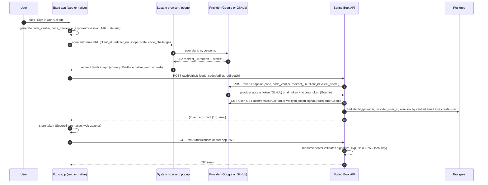

# Project 03, Appendix I: OAuth2 with React Native (Expo) and a Spring Boot Resource Server

[Back to the Project 03 guide](README.md)

*Replaces the old "Appendix I: OAuth2 Flow with Spring Security". Written 2026-10-13 against the docs linked inline. Expo and provider details change often: if a linked doc disagrees with this page, the doc wins, and please open an issue on this repo.*

---

## 0. Read this first

In P2 you learned the mobile pattern: the client does **Authorization Code + PKCE** against the provider, sends a **Bearer token** on every request, and the Spring Boot API is an **OAuth2 Resource Server** that validates tokens and never manages a login page or a session. P3 keeps that pattern and adds three complications:

1. **Two clients from one codebase** (Expo web + Expo Android/iOS) with **different redirect URIs**.
2. **Two OAuth providers**, one of which (GitHub) is not OpenID Connect and does not issue a JWT.
3. **One email, two providers.** The same person may sign in with Google one day and GitHub the next. The required behavior is safe and simple (section 3.5); merging both into one account is a **stretch goal**.

The old Appendix I described Spring Boot as an OAuth2 *Client* with a browser session. **Do not build that.** It undoes what P2 taught, it does not work for a native app, and it does not survive a web client and an API hosted on different origins.

> **Expo Go does not work for this project's auth.** You need a **development build**. Section 5 shows that a dev build on Android costs nothing and needs no account.

---

## 1. Why OAuth is hard here

### 1.1 Redirect URIs differ per platform

A provider sends the user back to a **redirect URI** it has on file. That URI is different on every platform you run:

| Where the app runs | What the redirect URI looks like | Notes |
|---|---|---|
| Web, local dev | `http://localhost:8081/auth` | Whatever port `npx expo start --web` prints. `localhost` is the only `http://` origin Google accepts; everything else must be HTTPS ([Google web-server](https://developers.google.com/identity/protocols/oauth2/web-server)). |
| Web, deployed | `https://<your-site>.onrender.com/auth` | Must be registered *exactly*: scheme, host, path, trailing slash. |
| Android / iOS dev build | `yourapp://auth` | `yourapp` is the `scheme` in `app.json`. Changing it requires a new native build ([Expo linking](https://docs.expo.dev/linking/into-your-app/)). |
| Expo Go | `exp://127.0.0.1:8081/--/auth` | Changes with your LAN IP, cannot be registered with providers, and Expo says Expo Go is not usable for OAuth. |

`makeRedirectUri()` from `expo-auth-session` produces the right value for the platform you are on ([reference](https://docs.expo.dev/versions/latest/sdk/auth-session/)). Your job is to make sure every value it can produce is registered with the provider.

### 1.2 Provider console setup differs per platform

- **Google** has separate OAuth client *types*. A **Web application** client has authorized JavaScript origins and redirect URIs and a client secret. An **Android** client is identified by **package name + SHA-1 signing fingerprint** and has no secret. An **iOS** client is identified by **bundle ID** and has no secret ([Manage OAuth clients](https://support.google.com/cloud/answer/15549257)). Every developer's debug keystore has a *different* SHA-1, so an Android client that works on your laptop fails on your teammate's until their fingerprint is added too.
- **GitHub** has one kind of OAuth App with up to **10 callback URLs** ([Creating an OAuth App](https://docs.github.com/en/apps/oauth-apps/building-oauth-apps/creating-an-oauth-app)). Apps created after **2026-08-03** use **exact** matching unless wildcard matching is enabled, so register every URL you use ([Authorizing OAuth apps](https://docs.github.com/en/apps/oauth-apps/building-oauth-apps/authorizing-oauth-apps)). (Expo's guide still says GitHub allows one redirect per app; that is out of date.)

### 1.3 PKCE support and what you get back

| Provider | PKCE | Secret needed at token endpoint? | Identity token you can verify offline |
|---|---|---|---|
| Google | Yes, `S256` recommended ([native-app](https://developers.google.com/identity/protocols/oauth2/native-app)) | Web client: yes, in practice. Android/iOS clients: no secret exists. | **Yes.** The `id_token` is an OIDC JWT signed with keys at `jwks_uri`; verify `iss`, `aud`, `exp`, signature ([Google OIDC](https://developers.google.com/identity/openid-connect/openid-connect)). The *access* token is opaque to you. |
| GitHub | Yes, `S256` only ("strongly recommended") | **Yes, always** in the web flow ([Authorizing OAuth apps](https://docs.github.com/en/apps/oauth-apps/building-oauth-apps/authorizing-oauth-apps)) | **No.** No OIDC, no `id_token`. You get an opaque `gho_…` access token and must call `GET /user` and `GET /user/emails`. |

The GitHub row is the whole reason the architecture in section 3 exists. A client secret cannot live in a web bundle or an APK (anyone can extract it), and GitHub will not complete the exchange without it. Something you control on a server has to do the exchange.

---

## 2. Provider choices

### 2.1 Google (OIDC)

Pros: issues a real JWT (`id_token`) with `sub`, `email`, `email_verified`; discovery document at `https://accounts.google.com/.well-known/openid-configuration`; keys at `https://www.googleapis.com/oauth2/v3/certs`; `iss` is `https://accounts.google.com` or `accounts.google.com` ([Google OIDC](https://developers.google.com/identity/openid-connect/openid-connect)). Use `sub` as the identifier, never `email`.

Cons: three client types to configure; Android needs SHA-1 fingerprints; Google says custom URI schemes are no longer supported on Android, so on native you use Google's own sign-in library rather than a generic OAuth redirect (section 4.3). An "External" project in **Testing** status is limited to 100 test users and 7-day grants, **but** that limit and the test-user list do not apply when you request only `openid email profile` ([Manage app audience](https://support.google.com/cloud/answer/15549945)). **Request only those scopes.**

### 2.2 GitHub (OAuth 2.0 only)

Pros: one OAuth App, up to 10 callback URLs, PKCE supported, no SHA-1 or bundle IDs, every student has an account, device flow available for CLIs.

Cons: no OIDC, no JWT; client secret required for the token exchange; email requires the `user:email` scope and a second call to `GET /user/emails`, which returns `email`, `primary`, `verified` ([REST: emails](https://docs.github.com/en/rest/users/emails)). Only trust `verified: true`.

### 2.3 Alternatives

- **Microsoft Entra ID**: full OIDC, PKCE, mobile redirect formats `msauth.<bundle-id>://auth` (iOS) and `msauth://<package>/<signature-hash>` (Android) ([MSAL redirect URIs](https://learn.microsoft.com/entra/msal/objc/redirect-uris-ios)). A good second OIDC provider if you want option (a) from section 3; needs a (free) Entra tenant.
- **Apple**: `expo-apple-authentication` exists, but Sign in with Apple needs an Apple Developer Program membership for the capability. App Store Review Guideline 4.8 (apps using third-party login must offer an equivalent privacy-preserving login) applies to **App Store distribution** ([guidelines](https://developer.apple.com/app-store/review/guidelines/)); a class project installed via dev build is not subject to it.
- **Identity brokers** (Auth0 free tier: 25,000 MAU and unlimited social connections ([auth0.com/pricing](https://auth0.com/pricing)); Supabase Auth: 50,000 MAU on the free plan and, since 2025, asymmetric signing keys with a public JWKS ([Supabase JWT signing keys](https://supabase.com/blog/jwt-signing-keys)); Firebase Auth: 50,000 MAU free; Clerk). A broker signs in with Google *and* GitHub for you and hands your app **one JWT from one issuer**, so your Spring API needs only `jwk-set-uri`. See section 3.3 for when this is the right call.
- **Discord**: not recommended; PKCE and custom-scheme support are not clearly documented (unverified).

### 2.4 Recommendation: Google + GitHub

Use **GitHub first** (web, Sprint 1) because it forces you to build the backend exchange that everything else reuses and has the least console setup. Add **Google second** (web then Android, Sprint 2) because it teaches OIDC ID-token verification and because its native path is the hardest thing in this project; you want the rest of auth already working when you start it.

---

## 3. Recommended architecture: backend token exchange, API mints its own JWT

### 3.1 The three options

| | (a) API validates two issuers' JWTs directly | **(b) Backend token exchange, API issues its own JWT** | (c) Identity broker (Auth0 / Supabase / Firebase / Clerk) |
|---|---|---|---|
| How | `JwtIssuerAuthenticationManagerResolver.fromTrustedIssuers(google, other)` ([Spring multitenancy](https://docs.spring.io/spring-security/reference/servlet/oauth2/resource-server/multitenancy.html)) | App does PKCE, posts code (or ID token) to `/auth/{provider}`; API finishes exchange, verifies identity, returns `app JWT` | Broker does all provider work; API trusts broker's JWKS |
| GitHub | **Impossible**: no JWT to validate | Works; secret stays on the API | Works |
| Secrets | None on client | On the API only | On the broker |
| One user across providers | Hard: two `sub`s, two `iss`; you must still map them to one user | Natural: `/auth/*` is where linking happens | Broker does it (often paid) |
| Web vs mobile | Same | Same | Same |
| What you learn | Resource server config | Resource server **and** token issuing, identity verification, linking: the real thing | Vendor SDK |
| Verdict | Only if both providers are OIDC (e.g., Google + Microsoft) | **Use this** | Escape hatch after Sprint 2, **costs auth points** (3.3) |

### 3.2 The flow



On native Google the first eight steps are replaced by `GoogleSignin.signIn()` returning an `idToken`, and step 7 becomes `POST /auth/google {idToken}`. Everything after that is identical.

### 3.3 When to pick the broker instead

A broker is an **escape hatch, not a starting point.** It is allowed only **after Sprint 2** (the 11/19 PR report) and only if both providers still do not work on web. Tell your instructor at the agile meeting, then switch to **Supabase Auth** (you may already have a Supabase project for the database) or Auth0. Enable Google and GitHub in the broker's dashboard, sign in with its JS SDK on web and native, and configure your API with `spring.security.oauth2.resourceserver.jwt.jwk-set-uri` pointing at the broker's JWKS and `issuer-uri` at its issuer.

**What it costs:** the Final Submission rubric row *OAuth2 sign-in* (3 points) is capped at **1 of 3** for a team that uses a broker. You keep a working product and every other auth row (ownership, roles, deletion) is graded normally. Write the ADR either way: why you switched, and what you would need to switch back.

### 3.4 The Spring Boot pieces

**Dependencies** (Gradle, Kotlin DSL):

```kotlin
implementation("org.springframework.boot:spring-boot-starter-oauth2-resource-server") // brings spring-security-oauth2-jose (Nimbus)
implementation("org.springframework.boot:spring-boot-starter-web")
testImplementation("org.springframework.security:spring-security-test")
```

You do **not** need `spring-boot-starter-oauth2-client` and you do **not** need an extra JWT library: `spring-security-oauth2-jose` already includes Nimbus, and Spring's `NimbusJwtEncoder` issues tokens ([NimbusJwtEncoder javadoc](https://docs.spring.io/spring-security/site/docs/current/api/org/springframework/security/oauth2/jwt/NimbusJwtEncoder.html)). (JJWT 0.13 is a fine alternative if you prefer its API: [github.com/jwtk/jjwt](https://github.com/jwtk/jjwt).)

**Configuration** (`application.yml`; every value comes from the environment, nothing here is a literal in code):

```yaml
app:
  jwt:
    issuer: ${APP_JWT_ISSUER:https://api.yourapp.example}
    secret-base64: ${APP_JWT_SECRET_BASE64}      # 32+ random bytes, base64. `openssl rand -base64 32`
    ttl: ${APP_JWT_TTL:PT1H}
  cors:
    allowed-origins: ${APP_CORS_ORIGINS:http://localhost:8081}
  oauth:
    google:
      web-client-id: ${GOOGLE_WEB_CLIENT_ID}
      web-client-secret: ${GOOGLE_WEB_CLIENT_SECRET}
    github:
      client-id: ${GITHUB_CLIENT_ID}
      client-secret: ${GITHUB_CLIENT_SECRET}
```

**Key, encoder, decoder** (one shared secret; the API is the only party that verifies its own tokens, so HMAC is enough):

```java
@Configuration
@EnableConfigurationProperties(AppJwtProperties.class)
class JwtConfig {

    private static final MacAlgorithm APP_JWT_ALG = MacAlgorithm.HS256;
    private static final String HMAC_KEY_ALGORITHM = "HmacSHA256";

    @Bean
    SecretKey appJwtKey(AppJwtProperties props) {
        return new SecretKeySpec(Base64.getDecoder().decode(props.secretBase64()), HMAC_KEY_ALGORITHM);
    }

    /** Validates OUR tokens. This is the bean the resource server filter uses. */
    @Bean
    JwtDecoder jwtDecoder(SecretKey appJwtKey, AppJwtProperties props) {
        NimbusJwtDecoder decoder = NimbusJwtDecoder.withSecretKey(appJwtKey).macAlgorithm(APP_JWT_ALG).build();
        decoder.setJwtValidator(JwtValidators.createDefaultWithIssuer(props.issuer())); // exp/nbf with 60s default skew + iss
        return decoder;
    }

    /** Issues OUR tokens. Constructor form works on Spring Security 6.x and 7.x;
     *  7.0 also offers NimbusJwtEncoder.withSecretKey(key).build(). */
    @Bean
    JwtEncoder jwtEncoder(SecretKey appJwtKey) {
        return new NimbusJwtEncoder(new ImmutableSecret<>(appJwtKey));
    }
}
```

```java
@Service
class AppTokenService {
    private static final String CLAIM_ROLES = "roles";
    private static final String CLAIM_EMAIL = "email";

    private final JwtEncoder encoder;
    private final AppJwtProperties props;

    String issueFor(User user) {
        Instant now = Instant.now();
        JwtClaimsSet claims = JwtClaimsSet.builder()
                .issuer(props.issuer())
                .issuedAt(now)
                .expiresAt(now.plus(props.ttl()))
                .subject(user.getId().toString())
                .claim(CLAIM_EMAIL, user.getEmail())
                .claim(CLAIM_ROLES, List.of(user.getRole().name()))
                .build();
        JwsHeader header = JwsHeader.with(MacAlgorithm.HS256).build();
        return encoder.encode(JwtEncoderParameters.from(header, claims)).getTokenValue();
    }
}
```

**Security filter chain** (resource server for everything except `/auth/**`, roles from our `roles` claim, CORS wired into Spring Security so preflights are not rejected with 401):

```java
@Configuration
@EnableMethodSecurity
class SecurityConfig {
    private static final String AUTH_PATHS = "/auth/**";
    private static final String ROLES_CLAIM = "roles";
    private static final String ROLE_PREFIX = "ROLE_";

    @Bean
    SecurityFilterChain filterChain(HttpSecurity http, CorsConfigurationSource cors) throws Exception {
        http
            .cors(c -> c.configurationSource(cors))
            .csrf(csrf -> csrf.disable())                       // bearer tokens, no cookies, no CSRF surface
            .sessionManagement(s -> s.sessionCreationPolicy(SessionCreationPolicy.STATELESS))
            .authorizeHttpRequests(a -> a
                .requestMatchers(HttpMethod.POST, AUTH_PATHS).permitAll()
                .requestMatchers("/actuator/health", "/v3/api-docs/**", "/swagger-ui/**").permitAll()
                .anyRequest().authenticated())
            .oauth2ResourceServer(o -> o.jwt(j -> j.jwtAuthenticationConverter(rolesConverter())));
        return http.build();
    }

    private JwtAuthenticationConverter rolesConverter() {
        JwtGrantedAuthoritiesConverter roles = new JwtGrantedAuthoritiesConverter();
        roles.setAuthoritiesClaimName(ROLES_CLAIM);
        roles.setAuthorityPrefix(ROLE_PREFIX);
        JwtAuthenticationConverter converter = new JwtAuthenticationConverter();
        converter.setJwtGrantedAuthoritiesConverter(roles);
        return converter;
    }

    @Bean
    CorsConfigurationSource corsConfigurationSource(AppCorsProperties props) {
        CorsConfiguration cfg = new CorsConfiguration();
        cfg.setAllowedOrigins(props.allowedOrigins());
        cfg.setAllowedMethods(List.of("GET", "POST", "PUT", "PATCH", "DELETE", "OPTIONS"));
        cfg.setAllowedHeaders(List.of(HttpHeaders.AUTHORIZATION, HttpHeaders.CONTENT_TYPE));
        UrlBasedCorsConfigurationSource source = new UrlBasedCorsConfigurationSource();
        source.registerCorsConfiguration("/**", cfg);
        return source;
    }
}
```

With that converter, `@PreAuthorize("hasRole('ADMIN')")` works and returns 403 for a valid token without the role, 401 for no/invalid token, exactly as P2 required. (Reference: [Spring resource server JWT](https://docs.spring.io/spring-security/reference/servlet/oauth2/resource-server/jwt.html).)

**Verifying a Google ID token** (a *second* decoder, built inside the service, deliberately **not** an unqualified `@Bean JwtDecoder` or it would collide with the one above):

```java
@Service
class GoogleIdentityVerifier {
    private static final String GOOGLE_JWKS = "https://www.googleapis.com/oauth2/v3/certs";
    private static final Set<String> GOOGLE_ISSUERS = Set.of("https://accounts.google.com", "accounts.google.com");

    private final NimbusJwtDecoder googleDecoder;

    GoogleIdentityVerifier(GoogleOAuthProperties props) {
        this.googleDecoder = NimbusJwtDecoder.withJwkSetUri(GOOGLE_JWKS).build();
        OAuth2TokenValidator<Jwt> iss = new JwtClaimValidator<String>(JwtClaimNames.ISS, GOOGLE_ISSUERS::contains);
        OAuth2TokenValidator<Jwt> aud = new JwtClaimValidator<List<String>>(JwtClaimNames.AUD,
                a -> a != null && a.contains(props.webClientId()));
        googleDecoder.setJwtValidator(new DelegatingOAuth2TokenValidator<>(JwtValidators.createDefault(), iss, aud));
    }

    /** Throws JwtException on bad signature, wrong iss/aud, or expiry. */
    ProviderIdentity verify(String idToken) {
        Jwt jwt = googleDecoder.decode(idToken);
        return new ProviderIdentity(Provider.GOOGLE, jwt.getSubject(),
                jwt.getClaimAsString("email"), Boolean.TRUE.equals(jwt.getClaimAsBoolean("email_verified")));
    }
}
```

The audience check is the same on web and native because the native library is configured with your **Web** client ID (`webClientId`), which makes Google put that ID in `aud` ([google-signin Original module](https://react-native-google-signin.github.io/docs/original)).

**Exchanging a code** (Google web path, GitHub both paths):

```java
@Service
class GitHubIdentityClient {
    private static final String TOKEN_URL = "https://github.com/login/oauth/access_token";
    private static final String USER_URL = "https://api.github.com/user";
    private static final String EMAILS_URL = "https://api.github.com/user/emails";

    private final RestClient http = RestClient.create();
    private final GitHubOAuthProperties props;

    ProviderIdentity exchange(String code, String codeVerifier, String redirectUri) {
        var form = new LinkedMultiValueMap<String, String>();
        form.add("client_id", props.clientId());
        form.add("client_secret", props.clientSecret());   // lives only here, never in the app
        form.add("code", code);
        form.add("code_verifier", codeVerifier);           // PKCE: the verifier the APP generated
        form.add("redirect_uri", redirectUri);             // must equal what the app used
        GitHubTokenResponse token = http.post().uri(TOKEN_URL)
                .accept(MediaType.APPLICATION_JSON)        // GitHub returns form-encoded without this
                .contentType(MediaType.APPLICATION_FORM_URLENCODED)
                .body(form).retrieve().body(GitHubTokenResponse.class);

        GitHubUser user = get(USER_URL, token.accessToken(), GitHubUser.class);
        List<GitHubEmail> emails = get(EMAILS_URL, token.accessToken(), new ParameterizedTypeReference<>() {});
        GitHubEmail primary = emails.stream().filter(e -> e.primary() && e.verified()).findFirst()
                .orElseThrow(() -> new AuthException("GitHub account has no verified primary email"));
        return new ProviderIdentity(Provider.GITHUB, String.valueOf(user.id()), primary.email(), true);
    }
}
```

Google's web path is the same shape against `https://oauth2.googleapis.com/token`, after which you call `GoogleIdentityVerifier.verify(response.idToken())` rather than any userinfo endpoint.

**The endpoint:**

```java
@RestController
@RequestMapping("/auth")
class AuthController {
    @PostMapping("/github")
    AuthResponse github(@Valid @RequestBody CodeExchangeRequest req) {
        return finish(gitHub.exchange(req.code(), req.codeVerifier(), req.redirectUri()));
    }

    @PostMapping("/google")
    AuthResponse google(@Valid @RequestBody GoogleAuthRequest req) {   // {idToken} OR {code, codeVerifier, redirectUri}
        ProviderIdentity id = req.idToken() != null
                ? googleVerifier.verify(req.idToken())
                : googleVerifier.verify(googleCodeClient.exchange(req).idToken());
        return finish(id);
    }

    private AuthResponse finish(ProviderIdentity identity) {
        User user = accountLinker.findOrCreate(identity);
        return new AuthResponse(tokens.issueFor(user), UserDto.from(user));
    }
}
```

### 3.5 User table and the email rule (linking is a stretch goal)

```sql
CREATE TABLE users (
  id             UUID PRIMARY KEY DEFAULT gen_random_uuid(),
  email          TEXT NOT NULL UNIQUE,
  display_name   TEXT,
  role           TEXT NOT NULL DEFAULT 'USER',
  created_at     TIMESTAMPTZ NOT NULL DEFAULT now()
);

CREATE TABLE identities (
  id                UUID PRIMARY KEY DEFAULT gen_random_uuid(),
  user_id           UUID NOT NULL REFERENCES users(id) ON DELETE CASCADE,
  provider          TEXT NOT NULL,              -- 'GOOGLE' | 'GITHUB'
  provider_user_id  TEXT NOT NULL,              -- Google 'sub' or GitHub numeric id, NEVER the email
  created_at        TIMESTAMPTZ NOT NULL DEFAULT now(),
  UNIQUE (provider, provider_user_id)
);
```

**Required rule** (graded under *OAuth2 sign-in*), in order:

1. Look up `identities` by `(provider, provider_user_id)`. Found: that is the user. Done.
2. Not found and the email is **not verified** (`email_verified` from Google, `verified` from GitHub is not `true`): **reject the login** (400, "verify your email at the provider") and persist nothing.
3. Not found, email verified, and **no** `users` row has that email: create the user and the identity.
4. Not found, email verified, and a `users` row **already** has that email (the person first signed up with the other provider): return **409** with a message naming the provider they used, and persist nothing.

**Stretch goal: account linking** (not graded; mention it in the demo if you build it). Replace rule 4 with: insert a new `identities` row pointing at the existing user (**link**), so either provider signs in to the same account. Only ever link on a **verified** email, for the reason below.

Why unverified emails are rejected outright: a user created from an unverified email would squat on that address. Under rule 4 the real owner could never sign up; with the linking stretch goal their *verified* login would be linked to the squatter's account, which is a reverse takeover (attacker registers first with unverified `victim@example.com`; victim later signs in with Google and lands on the attacker's account). Google sets `email_verified: true` for ordinary Google accounts and GitHub requires a verified primary email for most actions, so this rule costs real users nothing.

Deleting the account (an MVP requirement in the P3 guide) deletes the `users` row; `ON DELETE CASCADE` removes the identities.

---

## 4. The React Native / Expo client

### 4.1 Packages and app config

```bash
npx expo install expo-auth-session expo-crypto expo-web-browser expo-secure-store expo-dev-client
npx expo install @react-native-google-signin/google-signin   # Original module, MIT; native Google only
```

`app.json` (the `scheme` is the custom URL scheme providers redirect to on native; changing it means a new native build):

```json
{
  "expo": {
    "scheme": "yourapp",
    "android": { "package": "edu.csumb.cst438.yourapp" },
    "ios": { "bundleIdentifier": "edu.csumb.cst438.yourapp" },
    "plugins": [
      ["@react-native-google-signin/google-signin", { "iosUrlScheme": "com.googleusercontent.apps.<IOS_CLIENT_ID_NUMBER>" }]
    ]
  }
}
```

### 4.2 GitHub: one code path for web and native

`expo-auth-session` defaults to PKCE with `S256` (`usePKCE: true`) ([reference](https://docs.expo.dev/versions/latest/sdk/auth-session/)). `WebBrowser.maybeCompleteAuthSession()` must run on the page the popup lands on so the popup closes on web; it is a no-op on native ([expo-web-browser](https://docs.expo.dev/versions/latest/sdk/webbrowser/)).

```tsx
// features/auth/useGitHubLogin.ts
import { useEffect } from 'react';
import * as WebBrowser from 'expo-web-browser';
import { makeRedirectUri, useAuthRequest } from 'expo-auth-session';
import { api } from '@/lib/api';
import { tokenStore } from '@/lib/tokenStore';

WebBrowser.maybeCompleteAuthSession();

const GITHUB_DISCOVERY = {
  authorizationEndpoint: 'https://github.com/login/oauth/authorize',
  tokenEndpoint: 'https://github.com/login/oauth/access_token',
};
const GITHUB_SCOPES = ['read:user', 'user:email'];
const APP_SCHEME = 'yourapp';
const REDIRECT_PATH = 'auth';

export const redirectUri = makeRedirectUri({ scheme: APP_SCHEME, path: REDIRECT_PATH });
// native dev build -> yourapp://auth ; web dev -> http://localhost:8081/auth

export function useGitHubLogin(onSignedIn: () => void) {
  const [request, response, promptAsync] = useAuthRequest(
    { clientId: process.env.EXPO_PUBLIC_GITHUB_CLIENT_ID!, scopes: GITHUB_SCOPES, redirectUri },
    GITHUB_DISCOVERY,
  );

  useEffect(() => {
    if (response?.type !== 'success' || !request) return;
    const { code } = response.params;
    api.post('/auth/github', { code, codeVerifier: request.codeVerifier, redirectUri })
      .then(({ data }) => tokenStore.set(data.token))
      .then(onSignedIn);
  }, [response]);

  // Disable the button until `request` exists; call promptAsync only from a user tap (web popup rules).
  return { ready: !!request, signIn: () => promptAsync() };
}
```

Two things students get wrong: forgetting to send `request.codeVerifier` (the API cannot finish PKCE without it) and sending a `redirectUri` different from the one in the authorize request.

**The web popup needs a page to land on.** With Expo Router, `http://localhost:8081/auth` must match a route or the popup shows "Unmatched route" and never closes. Create a minimal `app/auth.tsx` (it can render a "Signing you in…" text) and call `WebBrowser.maybeCompleteAuthSession()` at module top level in the root `app/_layout.tsx`, not only inside the login hook, so it runs on whatever page the popup loads.

### 4.3 Google: two code paths

**Web:** the same hook as above with Google's discovery (`useAutoDiscovery('https://accounts.google.com')`), `clientId` = your **Web** client ID, `scopes: ['openid', 'email', 'profile']`, posting to `/auth/google` with `{code, codeVerifier, redirectUri}`. The API exchanges the code using the Web client secret and verifies the `id_token`.

**Native (Android/iOS):** Google states custom URI schemes are no longer supported on Android, and Expo deprecated its `expo-auth-session` Google provider, pointing at `@react-native-google-signin/google-signin` ([Expo Google auth guide](https://docs.expo.dev/guides/google-authentication/)). That library requires a **development build** (it will not run in Expo Go) and gives you an ID token directly:

```tsx
// features/auth/googleNative.ts  (Platform.OS !== 'web')
import { GoogleSignin } from '@react-native-google-signin/google-signin';

GoogleSignin.configure({
  webClientId: process.env.EXPO_PUBLIC_GOOGLE_WEB_CLIENT_ID,   // makes `aud` of the idToken your Web client ID
  iosClientId: process.env.EXPO_PUBLIC_GOOGLE_IOS_CLIENT_ID,
});

export async function signInWithGoogleNative() {
  await GoogleSignin.hasPlayServices();
  await GoogleSignin.signIn();
  const { idToken } = await GoogleSignin.getTokens();
  const { data } = await api.post('/auth/google', { idToken });
  await tokenStore.set(data.token);
}
```

Select the implementation with a `Platform.OS === 'web'` check in one `signInWithGoogle()` function so screens never know the difference.

### 4.4 Redirect URIs to register, per platform

| | Google Cloud console | GitHub OAuth App (one app, multiple callback URLs) |
|---|---|---|
| Web dev | Web client: JS origin `http://localhost:8081`, redirect URI `http://localhost:8081/auth` | Callback `http://localhost:8081/auth` |
| Web prod | Web client: add `https://<site>.onrender.com` and `https://<site>.onrender.com/auth` | Callback `https://<site>.onrender.com/auth` |
| Android dev build | **Android client**: package name + SHA-1 of *each* developer's debug keystore (and of the EAS keystore if you cloud-build). No redirect URI. | Callback `yourapp://auth` (unverified that GitHub accepts custom schemes; see fallback) |
| iOS dev build | **iOS client**: bundle ID; plugin `iosUrlScheme` = reversed iOS client ID | Callback `yourapp://auth` |
| Expo Go | Not supported | Not supported |

Get your debug SHA-1 (works before any native build; the debug keystore is created by the Android SDK tools):

```bash
keytool -list -v -keystore ~/.android/debug.keystore -alias androiddebugkey -storepass android -keypass android | grep SHA1
```

(After `npx expo run:android` you can also read it from `cd android && ./gradlew signingReport`, under `Variant: debug`.)

Every teammate adds theirs to the Android client, or you commit one shared `debug.keystore` and point `android/app/build.gradle` at it.

**Fallback if a provider rejects `yourapp://auth`:** register `https://<api>.onrender.com/auth/github/bounce` as the callback, and have that GET endpoint respond `302 yourapp://auth?code=...&state=...`. The app still holds the PKCE verifier and still posts `{code, codeVerifier, redirectUri}` to `/auth/github`; the `redirectUri` it sends is the bounce URL, because that is what the provider saw.

### 4.5 Storing the token

- **Native:** `expo-secure-store` (Keychain / Keystore). Expo's guidance is explicit: use SecureStore, not AsyncStorage, which is plain unencrypted storage ([Expo authentication guide](https://docs.expo.dev/guides/authentication/)). Some iOS versions reject values over ~2 KB ([SecureStore](https://docs.expo.dev/versions/latest/sdk/securestore/)); your 1-hour JWT with three claims is far under that.
- **Web:** SecureStore does not exist on web. Expo's current recommendation is a secure cookie set by the server ([develop/authentication](https://docs.expo.dev/develop/authentication/)). Because your API is on a different origin from your web app, a cookie means `SameSite=None; Secure`, credentialed CORS, and CSRF protection, which is more than P3 asks. The pragmatic class answer: a storage adapter that uses `localStorage` on web with a short-lived token, and say in your ADR that you accept the XSS exposure for a 1-hour token in a project with no user-generated HTML.

```ts
// lib/tokenStore.ts
import { Platform } from 'react-native';
import * as SecureStore from 'expo-secure-store';

const TOKEN_KEY = 'app_jwt';

const web = {
  get: async () => { try { return localStorage.getItem(TOKEN_KEY); } catch { return null; } },
  set: async (t: string) => { try { localStorage.setItem(TOKEN_KEY, t); } catch {} },
  clear: async () => { try { localStorage.removeItem(TOKEN_KEY); } catch {} },
};
const native = {
  get: () => SecureStore.getItemAsync(TOKEN_KEY),
  set: (t: string) => SecureStore.setItemAsync(TOKEN_KEY, t),
  clear: () => SecureStore.deleteItemAsync(TOKEN_KEY),
};
export const tokenStore = Platform.OS === 'web' ? web : native;
```

Attach it with an Axios/fetch interceptor that adds `Authorization: Bearer <token>` and, on a 401, clears the store and routes to the sign-in screen. **Logout** = `tokenStore.clear()` plus, for Google native, `GoogleSignin.signOut()`. Server-side revocation of a stateless 1-hour JWT is a stretch goal; document that it is not implemented.

### 4.6 What changes between web and native, in one list

| Concern | Web | Native dev build |
|---|---|---|
| Browser for the provider | `window.open` popup; needs `localhost` or HTTPS origin; must be triggered by a click | Chrome Custom Tab / `ASWebAuthenticationSession` |
| Redirect | `http(s)://origin/auth`; `maybeCompleteAuthSession()` closes the popup | `yourapp://auth`; no extra code |
| Google | `expo-auth-session` + Web client ID + backend exchange | `@react-native-google-signin` + Android/iOS clients + `{idToken}` |
| Token storage | `localStorage` adapter (or server cookie) | `expo-secure-store` |
| CORS | Required: API must allow your web origin | Not applicable |
| Running it | `npx expo start --web`, nothing to install | Build once with `npx expo run:android`; JS then hot-reloads |

---

## 5. Development builds on a free tier: the real numbers

### 5.1 What a development build is and why you need one

Expo Go is a prebuilt app that can only run native code it already contains. A **development build** is your own app, with `expo-dev-client`, your `scheme`, and any native libraries (such as Google Sign-In) compiled in ([Expo: development builds](https://docs.expo.dev/develop/development-builds/introduction/)). Expo Go cannot register your custom scheme and cannot run Google Sign-In, and Expo states it cannot be used for OAuth development ([Expo authentication guide](https://docs.expo.dev/guides/authentication/)). The `auth.expo.io` redirect proxy that used to paper over this was deprecated in SDK 48 and its APIs removed in SDK 49 ([Expo security advisory](https://blog.expo.dev/security-advisory-for-developers-using-authsessions-useproxyoptions-and-auth-expo-io-e470fe9346df)).

**Good news:** you rarely rebuild. JavaScript and TypeScript changes hot-reload into a dev build like Expo Go. You rebuild only when native config changes: `scheme`, package/bundle ID, a config plugin, or a new native library.

### 5.2 Your options, with costs (verified 2026-10-13)

| Option | Account? | Cost | Limits | Source |
|---|---|---|---|---|
| **Local Android build**: `npx expo run:android` | **No Expo account** | $0 | Needs Android Studio, JDK 17, Android SDK Platform 36; ~10 GB disk; first build 5–15 min | [Set up your environment](https://docs.expo.dev/get-started/set-up-your-environment/?platform=android&device=simulated&mode=development-build&buildEnv=local) |
| Local EAS build: `eas build -p android --profile development --local` | Expo account (`eas login`) | $0 | Same toolchain plus EAS CLI; one platform per run; probably outside the cloud quota (unverified) | [Local builds](https://docs.expo.dev/build-reference/local-builds/) |
| **EAS cloud build, Free plan** | Expo account | $0 | **15 Android + 15 iOS builds** per calendar month, **low-priority queue** (waits can exceed 90 minutes at peak), **45-minute timeout**, concurrency 1, no overage; when the quota is gone you wait for the 1st of the month, upgrade, or build locally | [expo.dev/pricing](https://expo.dev/pricing), [billing plans](https://docs.expo.dev/billing/plans/), [billing FAQ](https://docs.expo.dev/billing/faq/) |
| EAS Starter plan | Expo account | $19/month + usage ($45 build credit) | High-priority queue, 2-hour timeout | [expo.dev/pricing](https://expo.dev/pricing) |
| **iOS simulator build** (Mac only): `npx expo run:ios`, or EAS with `ios.simulator: true` | No Apple account for local | $0 | Xcode required; simulator cannot do push or camera; fine for OAuth | [Create a development build](https://docs.expo.dev/develop/development-builds/create-a-build/) |
| iOS **device** build via EAS | Apple Developer Program | **USD 99/year** | Expo: "All builds that run on an iPhone device require a paid Apple Developer account for build signing" | [Create a development build](https://docs.expo.dev/develop/development-builds/create-a-build/), [Apple enrollment](https://developer.apple.com/programs/enroll/) |
| iOS device build **locally** via Xcode with a free Apple Account ("Personal Team"): `npx expo run:ios --device` | Free Apple Account | $0 | Profiles expire after **7 days** (rebuild and reinstall), **3 apps per device**, **3 devices**, **10 App IDs** | [Apple: compare memberships](https://developer.apple.com/support/compare-memberships/), [Create a development build](https://docs.expo.dev/develop/development-builds/create-a-build/) |

### 5.3 Recommendation for this class

**Required: web + Android** (emulator or a physical Android device over USB). **iOS optional.** Every team member can produce the Android build on their own laptop for free with no account. Use EAS cloud builds only to hand an APK to a teammate without the Android toolchain (one build does that; the APK installs on any emulator or device). Teams with a Mac can add iOS simulator for free; a physical iPhone is only worth it if someone already pays for the Apple Developer Program.

### 5.4 Step by step: Android dev build running on an emulator

Commands from Expo's environment guide ([source](https://docs.expo.dev/get-started/set-up-your-environment/?platform=android&device=simulated&mode=development-build&buildEnv=local)); macOS shown, Windows equivalents are on that page.

1. **JDK 17.** `brew install --cask zulu@17`, then in `~/.zshrc`: `export JAVA_HOME=/Library/Java/JavaVirtualMachines/zulu-17.jdk/Contents/Home`.
2. **Android Studio.** Standard install. Settings → Languages & Frameworks → Android SDK → SDK Platforms: check **Android 16 (Baklava), Android SDK Platform 36** and its Sources. SDK Tools: **Android SDK Build-Tools** and **Android Emulator**.
3. **Environment.** In `~/.zshrc`:
   ```sh
   export ANDROID_HOME=$HOME/Library/Android/sdk
   export PATH=$PATH:$ANDROID_HOME/emulator:$ANDROID_HOME/platform-tools
   ```
   `source ~/.zshrc` and confirm `adb --version` works.
4. **Emulator.** Android Studio → More Actions → Virtual Device Manager → Create virtual device → a recent Pixel → download a system image → Finish → Play.
5. **Your project.** From a fresh branch (`git switch -c feature/android-dev-build`):
   ```sh
   npx expo install expo-dev-client
   npx expo run:android        # generates android/, compiles, installs on the running emulator, starts Metro
   ```
   First build takes several minutes. Subsequent `npx expo start` sessions reuse the installed build; press `a` to open it.
6. **Physical device instead:** enable USB debugging, plug in, `npx expo run:android --device`.
7. **Get your SHA-1** for the Google Android client: `keytool -list -v -keystore ~/.android/debug.keystore -alias androiddebugkey -storepass android -keypass android | grep SHA1`. Paste it into the Android OAuth client in Google Cloud.
8. **Confirm the scheme works** without any provider: `npx uri-scheme open "yourapp://auth?code=test" --android` should foreground the app ([Expo linking](https://docs.expo.dev/linking/into-your-app/)).
9. **Rebuild only when** you change `scheme`, `android.package`, plugins, or add a native library. Do not commit the `android/` folder unless your team decides to leave the managed workflow; add it to `.gitignore` and regenerate with `npx expo prebuild`.

For a teammate without the toolchain: `eas build -p android --profile development` once, with `eas.json`:

```json
{ "build": { "development": { "developmentClient": true, "distribution": "internal", "android": { "buildType": "apk" } } } }
```

---

## 6. Testing auth in CI and end-to-end

Playwright can drive *your* web app, but it cannot reliably drive Google's or GitHub's login pages: bot detection, 2FA prompts, consent screens that change, and rate limits make it flaky by design. Do not try. Instead:

### 6.1 Unit and slice tests: no keys at all

`spring-security-test` provides a `jwt()` request post-processor that injects a mock `Jwt` straight into the security context; your `JwtDecoder` is never called ([Spring: testing OAuth2](https://docs.spring.io/spring-security/reference/servlet/test/mockmvc/oauth2.html)):

```java
mvc.perform(get("/me").with(jwt().jwt(j -> j.claim("sub", USER_ID).claim("roles", List.of("USER")))))
   .andExpect(status().isOk());

mvc.perform(delete("/admin/users/42").with(jwt().jwt(j -> j.claim("roles", List.of("USER")))))
   .andExpect(status().isForbidden());

mvc.perform(get("/me")).andExpect(status().isUnauthorized());
```

Unit-test `AccountLinker` directly: same `(provider, provider_user_id)` returns the same user; an unverified email is rejected and **no user row is created**; a verified email already registered through the other provider returns 409 and creates nothing (or, if you built the stretch goal, links to the existing user); two different verified emails make two users. Unit-test `AppTokenService` + `jwtDecoder`: a minted token decodes; a token signed with a different key is rejected; an expired token is rejected; a token with the wrong `iss` is rejected.

### 6.2 End-to-end: a test-only profile that mints real app JWTs

Because your API already issues its own JWT, the test hook is tiny:

```java
@RestController
@Profile(TestAuthController.PROFILE)   // "e2e"
class TestAuthController {
    static final String PROFILE = "e2e";

    @PostMapping("/test/token")
    AuthResponse tokenFor(@RequestParam String email) {
        User user = users.findByEmail(email).orElseThrow();   // seeded by an e2e SQL script
        return new AuthResponse(tokens.issueFor(user), UserDto.from(user));
    }
}
```

Guard rails, all graded:

- The profile is activated **only** in the CI workflow (`SPRING_PROFILES_ACTIVE=e2e`) and in a local `docker compose -f compose.e2e.yml`. The Render service has no such variable. Add a startup check that throws if `e2e` and `prod` are both active.
- A test asserts that `TestAuthController` is **absent** from the context when the profile is not active (`@SpringBootTest` without the profile, `assertThat(ctx.containsBean(...)).isFalse()`).
- Playwright's setup project calls `POST /test/token?email=e2e-user@example.test`, writes the token into `localStorage` under your `TOKEN_KEY` via `page.addInitScript`, and saves `storageState` so every test starts signed in ([Playwright: authentication](https://playwright.dev/docs/auth)). One Playwright test should still click "Sign in with GitHub" and assert the client wiring without logging in: `const popup = await page.waitForEvent('popup')`, then `expect(popup.url()).toContain('github.com/login/oauth/authorize')` and `toContain('code_challenge=')`, then close it.

Write this choice up as an ADR ("How e2e tests authenticate in CI") and record the alternatives you rejected: a mock OIDC provider container, or a dev-signed JWT from a second key.

---

## 7. Sprint plan for auth, and the pitfalls checklist

Dates match Canvas as of 2026-10-13; **Canvas is authoritative** if they ever disagree. Each sprint ends with a PR report: the PR is open by **2:00 AM** on the due day and reviewed and merged by **10:00 AM** (the 8-hour rule from P2). No class the week of 11/23.

| When | Auth deliverable | Evidence |
|---|---|---|
| **Setup, 10/27–11/5** (proposal presentation Thu 11/5) | Team GitHub org and **public** repo created (never in `CST-438-projects`); Google Cloud project with Google Auth Platform configured (External, scopes `openid email profile` only), a **Web** client, an **Android** client; one GitHub OAuth App with the dev callbacks; `scheme` chosen; one teammate has `npx expo run:android` working; secrets in `.env` files that are git-ignored, with `.env.example` committed | Screenshot-free: `app.json` has `scheme`; `.env.example` lists every variable in section 3.4 |
| **Sprint 1, 11/5–11/12** (PR report Thu 11/12) | **Web login with GitHub → API mints JWT → one protected endpoint** returns 200 with the token and 401 without; `users`/`identities` tables; CORS working from `localhost:8081`; MockMvc tests for 401/403/200; auth sequence diagram in `/docs` | `POST /auth/github` and `GET /me` in `openapi.yaml`; CI green |
| **Sprint 2, 11/12–11/19** (PR report Thu 11/19) | **Android dev build** signing in with GitHub via `yourapp://auth`; **Google** on web (code exchange) and on Android (`google-signin` + `{idToken}`); the required email rule from 3.5 with unit tests; every teammate's SHA-1 registered; logout. Last point at which a team may switch to a broker (3.3). | Demo both providers on both platforms at the agile meeting; `AccountLinkerTest` |
| **Sprint 3, 11/19–12/3** (break week of 11/23; PR report Thu 12/3) | `e2e` profile + Playwright signed-in test in CI; roles (`ADMIN`) with 403 tests; delete account; production: Render env vars set, prod redirect URIs registered, HTTPS web build signs in against the live API | CI runs Playwright; live URL works |
| **Sprint 4, 12/3–12/8** (PR report and dry run Tue 12/8) | Polish and the ADRs (provider choice, architecture, e2e auth); stretch: account linking; iOS simulator if a Mac is available; do **not** start new required auth features | Dry run 12/8; Final Submission Wed 12/9 11:59 PM; presentation Thu 12/10 |

### Pitfalls checklist

- [ ] **`redirect_uri_mismatch` / "The redirect_uri is not associated with this application".** The URI in the request must byte-for-byte equal a registered one: scheme, host, port, path, trailing slash. Log `redirectUri` from `makeRedirectUri()` on each platform and compare.
- [ ] **Trying Expo Go.** `exp://…` cannot be registered and Google Sign-In will not load. Build the dev client.
- [ ] **Forgetting `codeVerifier`.** PKCE fails at the provider's token endpoint with `invalid_grant`. Send `request.codeVerifier` and the same `redirectUri` to your API.
- [ ] **Teammate's Android build fails Google sign-in (`DEVELOPER_ERROR` / status 10).** Their debug keystore SHA-1 is not registered. Add it, or share one debug keystore.
- [ ] **Google: "Custom URI scheme is not supported on Android".** You tried `expo-auth-session` with an Android client. Use `@react-native-google-signin` on native.
- [ ] **Extra Google scopes** put your project under the 100-test-user cap and 7-day expiry. Stay on `openid email profile`.
- [ ] **CORS.** Preflight `OPTIONS` returning 401 means CORS is not wired into Spring Security (`http.cors(...)`); a browser error naming the origin means the origin is not in `APP_CORS_ORIGINS`. Add both `localhost:8081` and the Render URL.
- [ ] **Web popup never closes.** The redirect path must be a real route (`app/auth.tsx`); `WebBrowser.maybeCompleteAuthSession()` must run on that page (put it in the root `_layout.tsx`), same origin as the opener; `promptAsync` must be called from a click; the origin must be `localhost` or HTTPS (a LAN IP fails with `ERR_WEB_BROWSER_CRYPTO`).
- [ ] **GitHub returns `access_token=…` as a query string.** You forgot `Accept: application/json`.
- [ ] **GitHub user has no verified email in `/user/emails`.** You asked for `read:user` without `user:email`, or the user's email is unverified. Reject with a clear message; do not link.
- [ ] **Clock skew.** `JwtTimestampValidator` allows 60 seconds by default; a Docker container with a drifted clock makes fresh tokens "expired" or "not yet valid". Check `date` inside the container before changing the skew.
- [ ] **Two `JwtDecoder` beans.** The Google verifier must not be an unqualified `@Bean JwtDecoder` or Spring will not know which one is the resource server's.
- [ ] **Tokens in AsyncStorage.** Unencrypted. Use SecureStore on native.
- [ ] **A client secret in the app bundle** (`EXPO_PUBLIC_*` is shipped to every user). Only `client_id`s are public. Secrets live in the API's environment (Render env vars, GitHub Actions secrets) and never in the image or the repo.
- [ ] **`e2e` profile reachable in prod.** Grade-losing and dangerous. Startup guard + the context test in 6.2.
- [ ] **EAS quota burned by rebuilding on every change.** JS hot-reloads; rebuild only for native changes; build locally by default.
- [ ] **Render cold start.** The first `/auth/*` call after idle takes a minute; show a spinner and do not assume the provider is broken.
- [ ] **Changing `scheme` late.** Every registered callback and every installed dev build is invalidated. Pick it in Setup and leave it.

---

## Sources

- Expo: [AuthSession reference](https://docs.expo.dev/versions/latest/sdk/auth-session/) · [Authentication with OAuth/OpenID providers](https://docs.expo.dev/guides/authentication/) · [Authentication in Expo apps](https://docs.expo.dev/develop/authentication/) · [Google authentication guide](https://docs.expo.dev/guides/google-authentication/) · [WebBrowser](https://docs.expo.dev/versions/latest/sdk/webbrowser/) · [SecureStore](https://docs.expo.dev/versions/latest/sdk/securestore/) · [Linking into your app](https://docs.expo.dev/linking/into-your-app/) · [Development builds](https://docs.expo.dev/develop/development-builds/introduction/) · [Create a development build](https://docs.expo.dev/develop/development-builds/create-a-build/) · [Set up your environment (Android, local)](https://docs.expo.dev/get-started/set-up-your-environment/?platform=android&device=simulated&mode=development-build&buildEnv=local) · [Local builds](https://docs.expo.dev/build-reference/local-builds/) · [Pricing](https://expo.dev/pricing) · [Billing plans](https://docs.expo.dev/billing/plans/) · [Billing FAQ](https://docs.expo.dev/billing/faq/) · [auth.expo.io security advisory](https://blog.expo.dev/security-advisory-for-developers-using-authsessions-useproxyoptions-and-auth-expo-io-e470fe9346df)
- Google: [OAuth 2.0 for mobile and desktop apps](https://developers.google.com/identity/protocols/oauth2/native-app) · [OAuth 2.0 for web server apps](https://developers.google.com/identity/protocols/oauth2/web-server) · [OpenID Connect](https://developers.google.com/identity/openid-connect/openid-connect) · [Manage OAuth clients](https://support.google.com/cloud/answer/15549257) · [Manage app audience / Testing status](https://support.google.com/cloud/answer/15549945) · [Using OAuth 2.0 (token expiry)](https://developers.google.com/identity/protocols/oauth2)
- GitHub: [Creating an OAuth App](https://docs.github.com/en/apps/oauth-apps/building-oauth-apps/creating-an-oauth-app) · [Authorizing OAuth apps](https://docs.github.com/en/apps/oauth-apps/building-oauth-apps/authorizing-oauth-apps) · [Best practices for OAuth apps](https://docs.github.com/en/apps/oauth-apps/building-oauth-apps/best-practices-for-creating-an-oauth-app) · [REST: user emails](https://docs.github.com/en/rest/users/emails)
- Spring Security: [Resource server, JWT](https://docs.spring.io/spring-security/reference/servlet/oauth2/resource-server/jwt.html) · [Multitenancy / JwtIssuerAuthenticationManagerResolver](https://docs.spring.io/spring-security/reference/servlet/oauth2/resource-server/multitenancy.html) · [Testing OAuth2 with MockMvc](https://docs.spring.io/spring-security/reference/servlet/test/mockmvc/oauth2.html) · [NimbusJwtEncoder](https://docs.spring.io/spring-security/site/docs/current/api/org/springframework/security/oauth2/jwt/NimbusJwtEncoder.html)
- React Native Google Sign-In: [Expo setup](https://react-native-google-signin.github.io/docs/setting-up/expo) · [Original module](https://react-native-google-signin.github.io/docs/original) · [License](https://react-native-google-signin.github.io/docs/license)
- Apple: [Compare memberships (Personal Team limits)](https://developer.apple.com/support/compare-memberships/) · [Enroll (USD 99/yr)](https://developer.apple.com/programs/enroll/) · [App Store Review Guidelines 4.8](https://developer.apple.com/app-store/review/guidelines/)
- Brokers: [Auth0 pricing](https://auth0.com/pricing) · [Supabase JWT signing keys](https://supabase.com/blog/jwt-signing-keys) · [Microsoft MSAL redirect URIs](https://learn.microsoft.com/entra/msal/objc/redirect-uris-ios)
- Other: [Playwright authentication](https://playwright.dev/docs/auth) · [JJWT](https://github.com/jwtk/jjwt) · [RFC 7636 PKCE](https://datatracker.ietf.org/doc/html/rfc7636)
